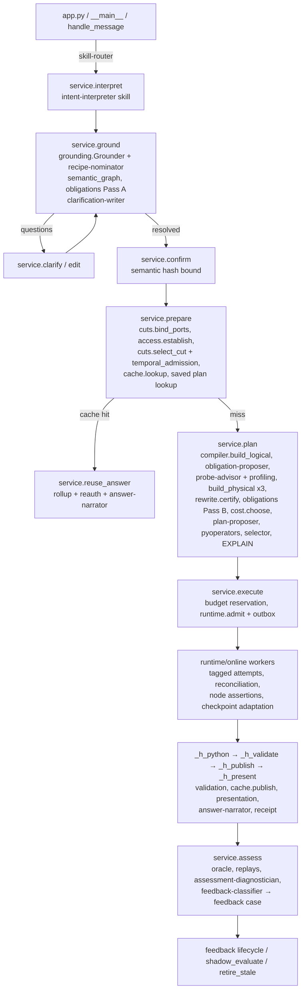

# Module and component reference

This document explains every module, catalog file, skill and test in the repository. It covers what each
one does, its main types and functions, which invariants it enforces, and which spec sections it implements.
Section references (§) point to the *Agentic Information Path Routing* architecture spec.
`docs/SPEC_COVERAGE.md` maps the spec to code from the other direction.

Contents

1. [Repository layout](#1-repository-layout)
2. [How a request flows through the modules](#2-how-a-request-flows-through-the-modules)
3. [Foundations](#3-foundations): `canonical`, `config`, `registry`, catalog files
4. [Meaning](#4-meaning-intent-grounding-obligations): `intent`, `grounding`, `semantic_graph`, `obligations`
5. [Data plane](#5-data-plane): `engines/*`, `fixture`, `oracle`
6. [Sources and access](#6-sources-and-access): `access`, `cuts`
7. [Planning](#7-planning): `compiler`, `sqlgen`, `profiling`, `rewrite`, `cost`, `selector`, `pyoperators`
8. [Execution](#8-execution): `runtime/online`, `runtime/temporal_adapter`, `validation`
9. [Reuse and records](#9-reuse-and-records): `cache`, `store`, `trace`
10. [Output and learning](#10-output-and-learning): `presentation`, `insights`, `assessment`, `feedback`, `recipe_builder`, `monitoring`
11. [Agent skills](#11-agent-skills-llm): `skills/`, `ipr/agents/*`
12. [Orchestration and entry points](#12-orchestration-and-entry-points): `service`, `__main__`, `app.py`
13. [Data model](#13-data-model)
14. [State machines](#14-state-machines)
15. [Configuration](#15-configuration)
16. [Tests](#16-tests)
17. [Extending the system](#17-extending-the-system)
18. [Implementation boundaries](#18-implementation-boundaries)

---

## 1. Repository layout

```
.
├── app.py                    Streamlit UI (presentation plane)
├── skills/                   Agent skills folder the LLM uses (Agent Skills format)
│   ├── README.md
│   └── <skill-name>/SKILL.md 11 skills: router, interpreter, nominator, … , recipe drafter
├── ipr/                      The Python package
│   ├── __init__.py           Package docstring, version, COMPILER_VERSION
│   ├── __main__.py           CLI: `python -m ipr demo | monitor`
│   ├── service.py            IPRService — orchestrates every phase (the control-plane API)
│   ├── canonical.py          JCS canonicalization, typed normalization, SHA-256 fingerprints
│   ├── config.py             Settings, business clocks
│   ├── registry.py           Loads the versioned catalog files
│   ├── catalog/*.json        Recipes, templates, operators, obligations, policies, evidence, packets,
│   │                         products, rewrite rules, semantic graph
│   ├── intent.py             Intent record model, semantic hash, edits, rule-based interpreter
│   ├── grounding.py          Metadata-only route resolution, questions, evidence selection
│   ├── semantic_graph.py     Entity/attribute/relationship resolver
│   ├── obligations.py        Two-pass obligation compiler and manifests
│   ├── access.py             Requester identity, effective access, re-authorization (ADR-01)
│   ├── cuts.py               Product port bindings, publication cuts, temporal admission
│   ├── compiler.py           Logical IR, physical variants, child graphs, SQL/graph validation
│   ├── sqlgen.py             Dialect-aware SQL for the approved operators
│   ├── profiling.py          Probes and profile store
│   ├── rewrite.py            Rewrite certification, result comparison, TLP, verifier adapter
│   ├── cost.py               Estimates, Pareto choice, warehouse pool, budget broker
│   ├── selector.py           Learned (Bao-inspired) variant selector
│   ├── pyoperators.py        Approved, digest-pinned Python operators
│   ├── validation.py         Node and final assertions
│   ├── cache.py              Coverage-aware information-set cache
│   ├── store.py              Control-plane SQLite store (schema + helpers)
│   ├── trace.py              Hash-linked trace store, OTel export
│   ├── presentation.py       Answer facts, chart spec, narrative, caveats, confidence
│   ├── insights.py           Per-statement diagnostic insights
│   ├── assessment.py         Metrics, gate vector, recommendations, assessment document
│   ├── feedback.py           Feedback case directory and lifecycle
│   ├── recipe_builder.py     Recipe draft builder
│   ├── monitoring.py         Monitoring snapshot and alerts
│   ├── fixture.py            Synthetic data products + hand-labeled edge cases
│   ├── oracle.py             Independent plain-Python reference implementation
│   ├── engines/              base.py (contract + UDFs), sqlite_engine.py, snowflake_engine.py
│   ├── runtime/              online.py (local durable runtime), temporal_adapter.py
│   └── agents/               registry, runner, providers, guards, offline engine, schema, stability
├── tests/                    pytest suite (fixtures in conftest.py)
├── docs/                     MODULES.md (this file), SPEC_COVERAGE.md
├── pyproject.toml / requirements.txt
└── .ipr_data/                Created at runtime (git-ignored): control.db, data.db, artifacts/, feedback/, recipes/
```

**Planes (§3).** The *presentation plane* is `app.py` and the CLI. The *control plane* is `service.py` plus the
modules it orchestrates, with state in `control.db`. The *data plane* is the engine plus `data.db`, which holds
the source products, staged relations and retained results.

---

## 2. How a request flows through the modules



Each arrow leaves a durable record and a trace span. These are listed per module below.

---

## 3. Foundations

### `ipr/canonical.py`: canonical hashing (§4.1)
Before meaning is hashed, two things must happen: the semantic payload is normalized by type, and it is
serialized deterministically.

| Function | Purpose |
|---|---|
| `jcs(value)` | RFC 8785 JSON Canonicalization Scheme serialization. Keys are sorted by UTF-16 code units and numbers use ECMAScript formatting. |
| `normalize_semantic(value, key)` | Versioned typed normalization (`semantic-normalization/v1`). Timestamps become UTC `…Z`, set-valued fields (`dimensions`, `output_grain`, `domains`) are sorted, units are lower-cased, and decimals become typed strings. |
| `fingerprint(value)` | `"sha256:" + sha256(jcs(normalize(value)))`. Semantic, coverage, cut, access, plan and result fingerprints all use it. |
| `to_utc_z`, `parse_ts` | Strict timestamp handling. Naive timestamps are rejected. |
| `stable_json` | Deterministic JSON for storage. It is not required to be JCS. |

### `ipr/config.py`: settings and clocks
* `Settings` holds the home directory (`IPR_HOME`, default `.ipr_data`), the worker count, lease and heartbeat
  timing, fixture size and seed, plan revision cap, stage and cache TTLs, and the business clock. Properties
  give the paths `control_db`, `data_db`, `artifacts_dir`, `feedback_dir` and `recipes_dir`.
* `FixedClock` is a business clock that starts at `2026-09-16T04:10:00Z`, the spec's example run time. It can
  advance with real time or stay frozen for tests, and `advance()` / `set()` move it forward to make later
  publications available. `SystemClock` returns the wall time.
* Durations are always measured with monotonic timers, so they don't depend on the business clock.

### `ipr/registry.py`: versioned registries (§5)
`load_registry()` returns a deep-copied `Registry` built from `ipr/catalog/*.json`. Every manifest and
receipt records `registry.versions`, the version string of each catalog file. Helpers:
* `recipe(id, version)`
* `recipe_ref(recipe)`, which returns the id, version, binding version and certificate reference
* `port("product/port")`, which returns the port contract with product authority and owner
* `evidence_by_id()`

### Catalog files: `ipr/catalog/`
| File | Contents | Used by |
|---|---|---|
| `recipes.json` | Certified recipes. `gross_submission_quote_conversion@2.0.0` is the target: submission identity, first-branch attribution, local half-open window, gross conversion. `quote_conversion@1.0.0` is legacy: per branch, UTC, inclusive window, deprecated but still supported. Each recipe defines aliases, patterns, applicability, allowed dimensions, `definitions` (bound into the intent), `algebra` (drives the compiler), input ports, operators, obligations, sufficient statistics and evidence claims. | grounding, compiler, cache, presentation |
| `metric_templates.json` | Obligations per metric type, plus `__unresolved__` (classification and definition obligations, so an unknown metric never yields an empty set). | obligations Pass A |
| `obligations.json` | Every obligation id with a description, `satisfied_by` sources (`evidence:`, `registry:`, `route`, `policy:`, `access_decision`, `cut_admission`, `certificate`, `runtime:`, `compiler:`), a runtime `validation` assertion id, and `implies` (closure). | obligations |
| `operators.json` | Approved logical and physical operators: accepted input grains, output grain, determinism class, declared obligations, permitted rewrite rules. | obligations Pass B, rewrite, plan-proposer guard |
| `policies.json` | Domain, access and temporal policies (Pass A obligations) and the `warehouse_admission_v2` budget policy: Gen1 rates, 60 s resume minimum, timeouts, probe and attempt limits. | obligations, cost, runtime |
| `evidence.json` | The five installed evidence fragments: claim, authority, version, locator, scope, validity interval, which obligations it satisfies, visibility. | grounding evidence selection |
| `packets.json` | The 20 reusable discovery packet families (P01–P20) across the three tiers. | evidence manifest (`packets_consulted`) |
| `products.json` | Authorized product ports (`quote_fdp/quoted_opportunities_v2`, `policy_fdp/known_bind_events_v2`): contract version, grain, base relation, snapshot adapter, replay retention, columns, row-access policy, registered statistics. | cuts, engines, profiling |
| `rewrite_rules.json` | Certified rewrite rules with preconditions: fused≡staged, semijoin key reduction, co-partitioned window reduction, combine partitions, derived roll-up. | rewrite certification, cache derived reuse |
| `semantic_graph.json` | Entities, relationships (with cardinality and certification), attributes with source mappings, metrics. | semantic_graph |

---

## 4. Meaning: intent, grounding, obligations

### `ipr/intent.py`: the intent record (§4)
* **Pydantic models.**
  * Request side: `Requester` (subject, tenant, purpose) and `IntentBody` (metric, population, scope, cohort,
    quote identity, attribution, bind and cancellation rules, timezone, `Window`, time basis, knowledge cutoff,
    `CutRequest`, maturity, dimensions, output grain, `Output`, resolved recipes).
  * Record and lifecycle: `Constraints` (credit targets, runtime limit, revision cap), `Clarification`,
    `Confirmation` and `IntentRecord` (the full template with version).
* **Semantic hash.**
  * `semantic_payload(rec)` is the hashed meaning. It excludes raw prose, budgets, presentation form, cut
    and access, and includes resolved material clarifications.
  * `semantic_hash(rec)` hashes that payload.
  * `coverage_payload` / `coverage_key` are the same payload without output dimensions; this is the cache
    reuse key.
* **Confirmation.**
  * `apply_edits(rec, edits)` applies dotted-path edits. If the semantic hash changes, a confirmed record
    becomes `invalidated`.
  * `confirmation_matches(rec)` is checked before resolving, planning and executing.
* **Interpretation.** `rule_based_interpret(text)` is the deterministic pattern interpreter. The offline
  `intent-interpreter` skill reuses it.

### `ipr/grounding.py`: metadata-only grounding (§2, §5)
`Grounder.ground(rec) → Resolution` reads only metadata, never business rows:

1. **Candidates.** Verified aliases, parameterized patterns or an explicit request, plus semantic-search
   nominations from the `recipe-nominator` skill (`_nominate`). Nominations are only candidates.
2. **Applicability.**
   * Hard rules on status, LOB, state and window bounds.
   * Each dimension is checked through `semantic_graph.resolve_dimension`.
   * Deprecated recipes need an explicit request.
3. **Pass A obligations** come from `ObligationCompiler.pass_a`.
4. **Outcomes.**
   * Several applicable definitions produce a `q_definition` clarification; different meanings are never
     cost-ranked into a hidden choice.
   * Missing parameters produce material questions (state, LOB, cohort, window, cutoff), each with a
     recommended answer.
5. **Binding.** `bound_fields` holds the recipe definitions to bind into the intent before confirmation.
6. **Evidence.** `select_evidence` runs a greedy set cover over the visible, in-scope, valid, uncontradicted
   fragments. It returns an evidence manifest with these fields per entry:
   * obligation, claim, locator, source hash and version
   * authority, scope, knowledge and business time
   * retrieval reason and contradiction status

   It also lists missing obligations and rejected fragments.

`Resolution.status` is one of `resolved | clarification_required | unsupported | missing_definition`.
Gaps are explicit, for example *"No authoritative evidence satisfies …"* or *"no certified source mapping for
driver_age"*. `end_of_local_day_utc` turns "as of 2026-09-15" into the end of that local day in UTC.

### `ipr/semantic_graph.py`: semantic graph (§5)
`SemanticGraph.resolve_dimension(dim, recipe)` walks relationships from the attribute's entity to the
metric's unit entity. It returns:
* `supported`, with the mapping, attribution and path;
* `clarification_required`, when the dimension is mapped but not certified as an output dimension;
* `unsupported`, when there is no mapping, no path, an uncertified link, or a port outside the recipe.

`attribute_names()` supplies the dimension vocabulary the interpreter skill uses.

### `ipr/obligations.py`: two-pass obligation compiler (§5)
* `Obligation` holds: id, description, severity, scopes, origins (kind, ref, version), `satisfied_by`,
  `validation`, `depends_on`, status, evidence, `added_by`, reason.
* `ObligationManifest` provides:
  * `add`, which merges origins and scopes. An unknown id becomes a blocking "undeclared" obligation.
  * `close`, the transitive closure over `implies`.
  * `merge_agent_proposal`, which accepts additions only. Remove, waive and mark-satisfied actions are
    recorded in `rejected_agent_actions`.
  * `evaluate(context, metadata_only)`, which sets status (`open`, `satisfied`, `pending_validation`,
    `validated`, `failed`, `unsatisfied`) from the facts available. These include evidence, route, products,
    access decision, cut admission, certificate, runtime capabilities, compiler checks and validation verdicts.
  * `blocking` and `metadata_blocking`.
  * `freeze`, which produces the manifest hash bound into the admitted plan.
* `ObligationCompiler.pass_a(metric_types, recipes, domains)` combines template, recipe and policy obligations.
* `ObligationCompiler.pass_b(manifest_a, logical, physical)` adds obligations declared by every operator,
  edge, port binding, output contract, materialized stage and physical operator. A missing operator
  declaration blocks the plan.

---

## 5. Data plane

### `ipr/engines/base.py`: engine contract
* Exceptions: `EngineError`; `SubmissionAckLost`, raised when the engine may have accepted a statement but
  the client lost the acknowledgement; `TokenExpired`, raised when the delegated identity expired.
* `QueryRecord` holds the query id, session, principal, `query_tag`, kind, SQL hash, status, timestamps, rows,
  elapsed time and error.
* `EngineSession` protocol: `set_query_tag`, `submit_async`, `status`, `cancel`, `fetch_all`.
* Deterministic helper functions. The SQLite engine registers them as UDFs; the Snowflake dialect uses native
  equivalents:
  * `udf_local_date` and `udf_add_local_days` implement same-local-time plus N calendar days, `domain_calendar_v1`.
  * `udf_utc_date`, `udf_day_start_plus`.
  * `udf_hash_mod` is the stable partition hash, `sha256_mod_v1`.
* `validate_relation_name` allowlists stage and result names (`stg_*`, `res_*`).

### `ipr/engines/sqlite_engine.py`: local engine (simulates the Snowflake contract)
* **`SQLiteEngine`**
  * Keeps bounded per-`(principal, purpose)` session pools (`acquire` / `release`); session settings are
    restored on release.
  * Delegated-token simulation: `expire_token` / `renew_token` / `token_expired`.
  * Records query history persistently in `engine_query_history`.
  * `query_history_by_tag` applies the result limit before the tag filter and reports whether the history
    window was complete.
  * Also provides: `operator_stats` (spill reported unavailable), relation helpers (`relation_exists`, `drop`,
    `rename`, `read`), and admin helpers for fixture metadata.
  * Fault injection through `faults`: `lose_ack`, `fail` (a substring or a tuple of substrings), `delay`.
* **`SQLiteSession`**
  * `_expand` replaces `{{port:product/port}}` with the product snapshot adapter (`first_pub_seq <= :seq`)
    plus a *simulated native* row-access policy that is evaluated at query time against
    `policy_state_mapping`. The compiler never writes authorization predicates.
  * `submit_async` runs the statement on a thread and returns a query id. A cancel can stop a statement
    before or during execution.
  * Also provides: `fetch_all` (metadata and probe reads), `explain` (EXPLAIN QUERY PLAN), `cancel` (interrupt).

### `ipr/engines/snowflake_engine.py`: live adapter (not integration-tested)
* Opens requester OAuth connections and sets `QUERY_TAG` before `execute_async`.
* Polls with `get_query_status`, cancels with `SYSTEM$CANCEL_QUERY`, and reconciles tags against query history.
* Expands ports to product-owned snapshot views, never base tables plus Time Travel.

### `ipr/fixture.py`: synthetic foundational data products
* `build_fixture(path, n_submissions, seed)` creates `data.db`. It contains:
  * `quote_branches` and `bind_events`, which are bitemporal: `knowledge_at`, `superseded_knowledge_at` and
    `first_pub_seq`;
  * `product_publications`, three publications per port with snapshot, watermark and completeness;
  * `policy_state_mapping` and `policy_meta` (policy version, entitlement epoch);
  * `fixture_meta`.
* The random data includes multi-branch submissions, a product rollout, late knowledge, corrections, withdrawn
  binds, cancellations and heavy-hitter submissions.
* `EDGE_CASES` and `EDGE_LABELS` are 15 hand-constructed submissions with independently hand-labeled outcomes.
  They cover window endpoints, a late-evening local quote, cross-branch binds, tie-breaks, draft branches, late
  knowledge, corrections, quality exclusions and immaturity. `EDGE_LEGACY_COHORT` covers UTC-versus-local
  cohort membership.
* `SUBJECTS` defines the demo requesters and their state entitlements.

### `ipr/oracle.py`: independent reference implementation
`oracle(db, params, identity, timezone, quote_seq, bind_seq, allowed_states)` recomputes both recipe algebras
in plain Python from raw rows. It never uses the compiler, the generated SQL or the UDFs. It returns aggregate
rows and a per-opportunity classification, and is used by tests and by `service.assess`.

---

## 6. Sources and access

### `ipr/access.py`: ADR-01 identity and reuse authorization (§3.1)
* `AccessProvider.establish(requester, ports) → AccessDecision`. The decision contains:
  * the subject, tenant, purpose and Snowflake user, plus the role context;
  * the effective states, policy version, entitlement epoch and policy dependencies;
  * a disclosure label (never sufficient for reuse on its own);
  * a fingerprint, the optional certified `access_class`, the reuse mode (`subject_scoped` or
    `certified_class`), and `allowed` with reasons.
* Classes are certified only when `certify_classes=True` and every policy dependency is known.
* `reauthorize(requester, ports, recorded)` re-evaluates current access before cache reads, stage reads and
  result pages. A changed fingerprint or class fails it.

### `ipr/cuts.py`: product bindings and source cuts (§12)
* `bind_ports(registry, recipe)` lists the authorized port contracts the recipe reads.
* `select_cut(engine, registry, bindings, cutoff, mode, now)` picks the publication for each port.
  * Pinned mode: the last complete, available publication whose knowledge watermark covers the cutoff.
  * Latest mode: the latest available publication, marked provisional.

  The result is a `SourceCut` with `CutEntry`s, a `fingerprint`, `seq_by_port` and `replayable_until`.
* `temporal_admission(cut, cutoff, now)` rejects future cutoffs, cutoffs after a watermark, and publications
  that are not yet available.

---

## 7. Planning

### `ipr/compiler.py`: typed information-plan compiler (§7, §10.1)
* **Logical IR.**
  * `build_logical(rec, recipe, registry)` builds six typed nodes, each with input and output grains,
    temporal meaning and declaration refs: `scoped_scan`×2, `canonical_event_selection`, `key_reduction`,
    `window_exists`, `aggregate_sufficient_stats`. It also records bindings, outputs and a
    `logical_fingerprint`.
  * `check_edges` verifies that every edge connects matching grains.
* **Physical plans.** `build_physical(logical, variant, stats, dialect, n_partitions)` builds one of three
  variants:
  * `fused`: one CTE statement.
  * `staged`: cohort, linked_binds, outcome and metric_stats as separate CTAS stages.
  * `partitioned`: cohort and binds are both labelled by the same opportunity-key hash, followed by N exact
    per-partition window reductions and an additive merge.

  Every node carries its SQL, parameters, dependencies, materialization, expected grain, assertions,
  checkpoint flag, row envelope, resource class and partition. The tail nodes are `validate`, `publish`
  and `present`.
* **Adaptation.** `replan_suffix(physical, completed, n)` produces a new plan version that keeps the
  completed cohort/linked_binds boundary and replaces only the unstarted suffix with an N-way co-partitioned
  reduction. This is how partitions are both added and combined.
* **Decomposition.** `annotate_child_graphs` / `child_graph_summary` group nodes into `quote_cohort_dag`,
  `linkage_dag`, `metric_dag` or `fused_metric_dag`, and `information_path`, with cross-graph edges.
* **Python operators.** `attach_python_operators(phys, selections)` inserts approved Python-operator nodes
  after the final aggregate.
* **Validation.**
  * `validate_graph` checks unique ids, known dependencies, acyclicity (Kahn), presence of the final and
    present nodes, and the node bound.
  * `validate_sql` checks the AST with sqlglot: a single read-only SELECT, no DDL or DML, only allowlisted
    tables (ports, `rel` placeholders, CTEs) and allowlisted functions.

### `ipr/sqlgen.py`: dialect-aware SQL for the approved operators
* `Dialect('sqlite' | 'snowflake')` maps local-date, add-local-days, UTC-date, day-start and hash-mod onto
  each engine.
* Each fragment implements one operator:
  * `cohort_sql`: canonical first-eligible-branch selection, with a deterministic tie-break, maturity and
    quality classification, and an optional partition label.
  * `linked_binds_sql`: committed binds known by the cutoff, resolved to the canonical key and semijoined to
    mature cohort keys.
  * `outcome_sql`: an EXISTS window reduction that keeps unmatched cohort rows and supports partition filters.
  * `aggregate_select`: additive counts plus provenance and validation columns (grain violations, window
    violations, max knowledge times).
  * `merge_sql`: the additive merge of partitions.
* All values are binds (`:name`); object names are placeholders only.

### `ipr/profiling.py`: useful mini queries (§6)
* `PROBES` lists six approved probes: `cohort_size`, `duplicate_canonical_key`, `bind_multiplicity`,
  `heavy_hitters`, `linkage_coverage` (null and unmatched keys) and `key_sample` (a deterministic key-aware
  1-in-50 sample, labelled approximate).
* `registered_estimates` turns catalog statistics into approximate estimates.
* `Profiler.collect(...)` decides for each probe:
  1. reuse an existing profile for the same cut, scope and access, or
  2. skip it when the probe-advisor says it can't change a decision, or
  3. ask the budget broker to admit it (falling back to a smaller warehouse class), then run it under the
     requester session.

  Each profile is stored with its cut, scope, time and exactness, and every decision is logged in `probe_log`.

### `ipr/rewrite.py`: rewrite validation (§7.1, §17)
* `certify_physical(physical, logical, registry)` gives each rule an evidence class, evaluates its
  preconditions and returns a verdict. The certificate lists the obligations it certifies and records the
  bounded-verifier result. A rule with unknown evidence fails admission.
* `bounded_verify` is the VeriEQL adapter. It reports `unsupported` when no verifier is installed.
* `compare_results(a, b, dims)` compares exact count statistics as bags, keyed by dimension.
* `tlp_check(session, from, predicate, …)` runs the Ternary Logic Partitioning metamorphic oracle for
  projection and filter queries.

### `ipr/cost.py`: estimates and budget admission (§8, §8.1)
* `CostModel.node_seconds` and `estimate` compute critical-path latency (p50/p90) and a simulated
  credit range, including the resume floor, retry allowance and stage-write count. `Calibration` learns
  observed/estimated ratios per operator from receipts.
* `pareto_frontier` / `choose`: feasibility (credit target and runtime limit) works as a constraint. Among
  feasible plans the choice minimizes a normalized objective on the frontier.
* `WarehousePool` simulates warm and suspended warehouses.
* `BudgetBroker` handles resume-floor arithmetic, probe admission with smaller-class alternatives, and
  incremental reservations per execution.

### `ipr/selector.py`: learned variant selection (§8, Bao-inspired)
* `signature(recipe, dims, stats)` defines the workload signature: recipe, dimensions, and log₂ buckets for
  cohort size and fan-out.
* `VariantSelector.select(...)` stays `rule_based` until every frontier arm has at least `min_samples`
  comparable receipts. After that it runs epsilon-greedy over measured mean latency, and only explores arms
  within a cost ratio. It records features, arms, mode, selection probability and baseline.
* `observe(...)` is called from `_h_present` for every execution.

### `ipr/pyoperators.py`: approved Python operators (§7)
* `PY_OPERATORS` currently holds one operator, `wilson_interval@1.0.0`. It is pinned by a code digest, the
  runtime version and a stdlib-only lock, and its determinism class is `deterministic_float_tolerance`.
* `validate_params` enforces declared bounds (confidence level 0.8–0.99); `verify_digest` checks the pin.
* Agents choose an operator by id and parameters only; no code ever comes from an agent.

---

## 8. Execution

### `ipr/runtime/online.py`: always-running local durable runtime (§10.3–10.5)
**`OnlineRuntime`** runs four kinds of thread: an outbox relay, a janitor, and N warm workers.

* **Admission.** `admit(...)` writes the execution, its nodes and an outbox row in one transaction, then
  returns at once with the admission latency. Optional `not_before` defers the start (execution state
  `queued`). Shareable nodes (same SQL, parameters, cut and access) become `waiting_shared` on an existing
  producer.
* **Relay.** The relay claims outbox rows and starts the workflow idempotently, using the stable
  `workflow_id = wf_<execution>`. A workflow with a cancel requested never starts.
* **Claiming.** `_claim` uses `BEGIN IMMEDIATE`, the local analogue of `FOR UPDATE SKIP LOCKED`. It orders by
  fair share across principals, then critical-path priority, then admission time. It sets a lease and
  increments a **fencing token**.
* **Per-node admission.** Before a node runs, the runtime checks:
  * cancellation;
  * the whole-execution deadline;
  * `on_node_admission`, a re-authorization in which a policy or entitlement change aborts the remaining
    stages;
  * resource tokens per warehouse class;
  * `on_stage_cost`, an incremental budget reservation.
* **SQL nodes (`_run_sql`).**
  1. Persist the attempt first: id, fence, structured `QUERY_TAG`, SQL and parameter hashes, and a
     deterministic `stg_<exec>_<node>_<attempt>` relation registered as a private stage with expiry.
  2. Acquire the requester session and `submit_async` the CTAS.
  3. Heartbeat the lease while polling. A per-statement timeout cancels the statement.
  4. Run node assertions.
  5. Complete with compare-and-set on the fence, so a stale owner cannot publish.
  6. Resolve waiters, evaluate the checkpoint (adaptation runs before dependents unlock), then unlock
     dependents.
* **Reconciliation (`_reconcile`).** After a lost acknowledgement or an expired lease (janitor → `reconcile`),
  the runtime searches tagged query history:
  * exactly one match: adopt that query id;
  * several matches, or a truncated history window: unresolved;
  * no match, but the stage relation exists: unresolved;
  * no match and no relation: known no-effect, so a new attempt is allowed.

  It never blindly resubmits.
* **Handler nodes.** `python_op`, `validate`, `publish` and `present` call service handlers.
* **Adaptation (`_checkpoint`).** The service's `adaptation_policy` may propose a new plan version. The
  runtime applies it only if every node in the old suffix is still `pending` or `ready`. Old nodes become
  `superseded`, and new physical plan and adaptation records are written.
* **Janitor.** Lease expiry moves a node to `reconcile`. The janitor also does cancellation bookkeeping and
  sweeps expired stages using the business clock.
* **Control API.** `cancel` keeps producers that still have waiters; `status`, `wait` and `resume` (after token
  renewal) round it out. `faults["die_after_submit"]` simulates a worker crash.

### `ipr/runtime/temporal_adapter.py`: ADR-02 target (not integration-tested)
* A generic Temporal workflow that interprets the immutable certified graph and starts ready nodes as
  activities with retry policies.
* SQL, LLM and planning work stays inside activities, so workflow replay remains deterministic.

### `ipr/validation.py`: runtime obligation checks (§9, §11, §13)
* `node_assertions(session, node, relation)` checks grain uniqueness of the cohort, binds and outcome, and
  partition cover. It runs immediately after a stage.
* `final_assertions(session, final_relation, cutoff, stages, assertions)` checks:
  * final grain uniqueness;
  * outcome-grain duplicates inside fused or partitioned statements;
  * conservation: `eligible_all = mature + immature + quality`, and equal to the cohort row count;
  * `converted ≤ eligible_mature`;
  * no future knowledge;
  * the half-open window;
  * partition conservation.

  Each verdict records the observed value.
* `stage_registration` checks that each stage is private to its principal and carries an expiry.

---

## 9. Reuse and records

### `ipr/cache.py`: coverage-aware information sets (§13)
* `InformationCache.publish(...)` refuses partial or failed results. It writes the full manifest:
  * fingerprints (semantic, coverage, source cut, access), plus the source-cut vector, access mode and class,
    and policy version;
  * the coverage block and metric state;
  * completeness, exactness and validation;
  * the producer execution, request and receipt;
  * the relation reference, replay horizon, freshness deadline, expiry and result digest.
* `lookup(rec, recipe, cut, access, requester, ports) → CacheDecision`:
  * Exact reuse needs the same coverage key, cut, access key and dimensions.
  * *Derived* reuse is allowed when the requested dimensions are a strict subset; it uses
    `rw.derived_rollup_sum_v1`.
  * Every rejected candidate gets a reason (coverage diff, cut, expiry, freshness, policy, access, missing
    dimension).
  * Every read is re-authorized.
  * Availability is `recomputable`, or `retained_result_only` once past the replay horizon.
* `rollup(rows, dims)` sums counts and recomputes rates; it never averages rates.
* Invalidation: `invalidate_policy_change`, `invalidate_latest_on_publication`, `evict_expired` (keeps the
  manifest).

### `ipr/store.py`: control-plane store
`Store` is a thread-local SQLite connection with WAL mode and a busy timeout:
* `tx()` opens `BEGIN IMMEDIATE`;
* `q`, `one` and `x` are the query, single-row and execute helpers;
* `dumps` / `loads` handle JSON.

`SCHEMA` defines every control table (see [§13](#13-data-model)). This is the local stand-in for the Aurora
domain store.

### `ipr/trace.py`: hash-linked trace (§14)
* `TraceStore.span(request_id, stage, …)` appends one normalized envelope. The envelope contains:
  * trace, span and parent ids; request and execution ids; stage and attempt;
  * input refs, the decision, output refs, expectations and observations;
  * cut mode and replay horizon, status and actor.

  The chain is `hash = sha256(prev_hash + jcs(event))`.
* `verify(anchor)` detects modification when compared with a trusted anchor. It is tamper-evident, not
  tamper-proof.
* `export_otel(request_id)` produces OpenTelemetry-shaped spans.
* Agent invocations add `agent:<skill>` spans whose `actor` names the skill, provider and model.

---

## 10. Output and learning

### `ipr/presentation.py`: presenting results (§15)
* `answer_facts(rows, dims, …)` builds totals and per-dimension facts:
  * counts, conversion rate, immature and quality-exclusion rates, and a Wilson CI when present;
  * the source cut, cutoff, window and cohort;
  * the follow-up imbalance.
* `chart_spec(facts)` produces a deterministic Vega-Lite bar or grouped-bar chart.
* `narrative` / `caveat_list` produce deterministic prose and caveats. The caveats cover mature-only rates,
  association versus causation, the identity and attribution rule, cancellation treatment, imbalance and
  provisional cuts.
* `confidence_categories` returns evidence categories rather than a single confidence score.

### `ipr/insights.py`: per-statement insights (§20)
`collect(nodes, attempts, explain)` produces, for each completed statement:
* `exploding_join` (linked rows per cohort row);
* `cardinality_outside_envelope`;
* `full_scan_predicate` (from EXPLAIN);
* `spill`;
* `queued_overload`.

Each insight records `available`, plus `triggered` or a reason. An absent insight means *unknown*, not *pass*.

### `ipr/assessment.py`: assessment metrics (§16)
* `compute_metrics(receipt, context)` returns:
  * accuracy and coverage: intent accuracy, retrieval completeness, obligation closure, supported coverage,
    business accuracy, oracle agreement, plan equivalence, consistency;
  * performance and cost: latency, ETA calibration, cost, cardinality Q-error per node (zero cases
    separate), plan-selection regret, adaptation payoff;
  * safety and integrity: verification coverage, join safety, spill, cache quality, evidence integrity.

  An unmeasurable metric is `None` with a reason.
* `gate_vector` returns semantic admission, access, temporal consistency, structural validity and result
  verification. These are never collapsed into a single score.
* `recommendations` gives rule-based, change-classified recommendations.
* `build_document` writes the markdown assessment, and `new_case` writes the case JSON (applicability,
  versions, promotion state).

### `ipr/feedback.py`: feedback context lifecycle (§17)
* `FeedbackDirectory` stores one folder per case at `feedback/<case_id>/case.json` (+ `assessment.md`).
* `transition` moves a case through `proposed → evaluated → approved → active → superseded / rejected`.
  Activating a semantic, operator or compiler change requires independent regression.
* `retire_stale` supersedes physical-plan or presentation advice when compiler or registry versions change.
* `retrieve(recipe, domains, scope)` returns only approved or active, applicable, advisory cases.

### `ipr/recipe_builder.py`: recipe builder (§18)
* `QUESTIONS` holds the six obligation-driven questions: identity, event, population, window, cancellation
  and maturity. `INSTALLED` maps the installed algebras to their answers, and `ADVERSARIAL` lists the
  adversarial example cases.
* `RecipeBuilder.build_draft(...)` writes `recipes/drafts/<id>/v<n>.json`. A draft has status `draft`, no
  certification, a list of certification requirements and adversarial examples with no approved outcomes.
  `match_installed` reports whether the draft is equivalent to an installed recipe or lists its unsupported
  meanings.

### `ipr/monitoring.py`: monitoring (§20)
`snapshot(store, clock)` reports:
* request clarification and unsupported rates, executions by state, failure rate;
* queue depth, cache hit rate and events, attempt states;
* telemetry availability, agent invocations by skill and provider (with fallbacks and latency);
* blocked grain violations, missing receipts, abandoned stages and median Q-error.

It also raises alerts against a workload-calibrated policy.

---

## 11. Agent skills (LLM)

### `skills/`: the skills folder the LLM uses
Each `skills/<name>/SKILL.md` contains:
* YAML frontmatter with `name` and `description` (the standard Agent Skills fields; the description is what
  the LLM reads to choose a skill) and a `metadata` block (version, phase, effort, authority, may, may_not,
  consumers);
* a body with an overview, the `## System prompt` and the `## Output schema` (JSON Schema).

| Skill | Phase | Called from | Guard highlights |
|---|---|---|---|
| `skill-router` | route | `service.handle_message` | Must pick an entry point; sees only the catalog |
| `intent-interpreter` | interpret | `service.interpret` | Dates, state, LOB, window; unknown dimensions stay visible |
| `recipe-nominator` | ground | `Grounder._nominate` | Registered recipe ids and versions only |
| `clarification-writer` | clarify | `service._write_clarifications` | Same questions and options; no new numbers |
| `obligation-proposer` | plan | `service.plan` | Add only; registry ids; removals rejected |
| `plan-proposer` | plan | `service.plan` | Approved operators; certified path or `semantic_delta`; frontier-only preference; bounded Python operators |
| `probe-advisor` | plan | `service.plan` → `Profiler.collect` | Approved probes; broker still admits |
| `answer-narrator` | present | `service._narrate` | Every number traces to facts; claims resolve; no causal language; valid chart fields |
| `assessment-diagnostician` | assess | `service.assess` | Evidence must cite metrics; no bypass advice |
| `feedback-classifier` | improve | `service.assess` / router | Bypass requests flagged, never actioned |
| `recipe-drafter` | build recipe | `service.draft_recipe_answers` / router | Offered options only; unresolved stays unresolved |

### `ipr/agents/`
| Module | Purpose |
|---|---|
| `registry.py` | `load_skills()` reads `skills/*/SKILL.md` with YAML. `validate_frontmatter` checks that the name is lowercase-hyphen and equals its folder, that the description is required, at most 1024 characters and has no XML, and that the required metadata is present. `Skill` holds the parsed definition (with `context_hash`); `catalog()` returns only names and descriptions. |
| `providers.py` | `LLMProvider` protocol, `ProviderError` and `Completion`. `ClaudeProvider` (`claude-opus-5-5`) passes `output_config.format = json_schema` with the skill's schema and the skill's effort, uses server-side refusal fallback (`fallbacks="default"`), and handles refusal and truncation. `CortexProvider` is the Snowflake Cortex COMPLETE adapter. `OfflineProvider` dispatches to `offline.OFFLINE`. `ReplayProvider` returns the accepted output recorded for the same skill version and prompt hash. `default_provider()` reads `IPR_LLM_PROVIDER` and the credentials. |
| `runner.py` | `AgentRunner.invoke(skill, inputs, guard, request_id, execution_id) → SkillResult`. It JSON-normalizes the inputs, computes the prompt hash, calls the provider, validates the schema and applies the guard. On failure it falls back to the offline engine, whose output must also pass. It writes an `agent_invocations` row (provider, model, prompt, context and response hashes, inputs, output, fallback reason, rejected parts, latency) and an `agent:<skill>` trace span. |
| `guards.py` | One factory per skill (`interpreter_guard`, `nomination_guard`, `clarification_guard`, `obligation_guard`, `plan_guard`, `probe_guard`, `narration_guard`, `diagnosis_guard`, `drafter_guard`, `router_guard`). Each returns a `GuardResult` (usable, filtered output, rejected parts, notes). The narration guard is the numeric claim checker. |
| `offline.py` | The deterministic implementation of every skill, used with no credentials and as the fallback. |
| `schema.py` | A minimal JSON-Schema validator for the subset the skills use. |
| `stability.py` | `evaluate_stability` repeats a skill, optionally concurrently, and reports agreement among canonical outputs. Rationale and prose are excluded from the comparison. |

---

## 12. Orchestration and entry points

### `ipr/service.py`: `IPRService`, the control-plane API (§8)
* **Construction.**
  * Builds the fixture and wires the registry, engine, store, trace, access provider, cache, agent runner,
    semantic graph, grounder, obligation compiler, cost model, budget broker, profiler and selector.
  * Also wires the feedback directory, recipe builder and runtime, the runtime's handlers, and its hooks:
    `adaptation_policy`, `on_stage_cost`, `on_node_admission`.
  * Options: `llm_provider`, `certify_access_classes`, `start_runtime`.
  * `RequestState` keeps each request's record, resolution, meaning presentation, prepared bindings, plan and
    executions.

| Method | Phase | What it does |
|---|---|---|
| `handle_message` | route | Runs the `skill-router`, then the interpreter, feedback assessment or recipe drafting |
| `interpret` | interpret | Runs the `intent-interpreter` skill and creates the draft `IntentRecord` and request records |
| `ground` | ground | Runs the `Grounder` and binds definitions. Retires stale advice, retrieves advisory feedback, runs `clarification-writer`, and persists the resolution and Pass A manifest |
| `clarify`, `edit` | clarify | Apply answers or edits, invalidating confirmation when meaning changes, then re-ground |
| `confirm` | confirm | Binds the approved semantic hash. Raises `Gap('confirmation_blocked')` when the request isn't resolved |
| `prepare` | resolve + reuse | Ports, requester access, source cut and temporal admission, cache lookup, saved-plan applicability |
| `reuse_answer` | reuse | Validates and presents a cache hit, re-running approved Python operators on cached counts, and writes a cache-operation receipt |
| `plan` | plan | Logical IR. The obligation-proposer, probe-advisor and profiler run. Three physical variants follow: certification, Pass B, estimates, EXPLAIN. Then the Pareto choice, plan-proposer and Python operators, and the learned selector. Content-addressed plan artifacts are saved before execution |
| `admission_decision`, `set_preferences`, `preferences` | estimate | Preference envelope for automatic admission |
| `execute` | execute | Budget reservation, runtime admission (publish/share flags, `defer_until`, statement timeout, deadline) |
| `_h_python`, `_h_validate`, `_h_publish`, `_h_present` | runtime handlers | Approved operator run; final assertions plus digest and stage checks; compare-and-set result manifest, `res_` relation and cache publish; facts, narration and receipt, plus selector and calibration updates |
| `_adaptation_policy`, `_node_admission`, `_stage_cost` | runtime hooks | Checkpoint suffix replanning; re-authorization before stages; incremental reservations |
| `result`, `wait`, `cancel` | status | Presentation payload / runtime passthroughs |
| `page_result`, `export_result` | output | Re-authorized paginated reads; governed CSV export with a manifest |
| `ask` | all | Convenience path through the whole protocol, honouring the preference envelope |
| `replay`, `run_oracle`, `assess`, `shadow_evaluate` | assess / improve | Same-cut replays (no publish, no sharing), the independent oracle, the assessment document and case, shadow regression |
| `draft_recipe_answers`, `build_recipe_draft` | build recipe | `recipe-drafter` proposals, and drafts that record the agent proposal and user overrides |
| `monitoring`, `set_policy_mapping`, `bump_policy_version`, `request_summary` | admin | Monitoring snapshot and policy administration for demos and tests |

`Gap(kind, message, detail)` is the explicit terminal-gap exception. Its kinds include:
`confirmation_blocked`, `not_confirmed`, `access_denied`, `temporal_admission`, `semantic_delta`,
`uncertified_plan`, `identity_violation`, `no_admissible_path`, `budget` and `not_admitted`.

### `ipr/__main__.py`: CLI
* `python -m ipr demo [--question … --subject … --variant … --compare-variants --provider offline|claude|replay]`
  runs the full workflow and the assessment, then prints the agent narrative, the deterministic narrative,
  the skills used and the gates.
* `python -m ipr monitor` prints the monitoring snapshot.

### `app.py`: Streamlit UI (presentation plane)
* **Sidebar:** requester (delegated identity), LLM provider, admission preferences.
* **Tabs:**

  | Tab | What it does |
  |---|---|
  | **Ask** | Routed message box; recipe-grounded summary and business questions; confirm; resolve and reuse; plan table; execute or defer; answer with agent narrative, verified claims, chart, CI; paging and export |
  | **Execution** | Nodes, attempts, receipt |
  | **Plan & obligations** | Logical IR, frozen Pass B manifest, certificate, SQL, probe log, agent proposals, child graphs and EXPLAIN, learned selection |
  | **Agent skills** | Catalog with descriptions, prompts and schemas; invocation receipts; stability check |
  | **Cache** | Cache entries |
  | **Assess & feedback** | Assess; replay variants; approve or reject cases |
  | **Recipe builder** | Agent-prefilled form; drafts |
  | **Monitoring** | Monitoring snapshot and alerts |
  | **Trace** | Chain verification and spans |

---

## 13. Data model

**`control.db`** (`store.SCHEMA`, plus the agent and selector tables):

| Table | Holds |
|---|---|
| `requests`, `intents`, `confirmations`, `resolutions` | Raw request and interpretation receipt; every intent version with its semantic hash and status; confirmations; resolutions |
| `obligation_manifests` | Pass A per request version; Pass B frozen per plan version |
| `logical_plans`, `physical_plans`, `plan_applicability` | Persistent plan registry. Physical plans include certificates and the parent version (adaptations) |
| `executions`, `nodes`, `node_attempts`, `adaptations`, `outbox` | Execution instances (cut, access, budget, estimate, state), node state with lease/fence/share fields, tagged attempts with reconciliation evidence, plan versions, durable outbox (`not_before`) |
| `stages`, `result_manifests`, `receipts` | Stage registry (owner, expiry, state); compare-and-set result manifests; execution and cache-operation receipts |
| `cache_entries`, `cache_events`, `profiles` | Information sets, cache audit events, profile store |
| `trace_events`, `telemetry` | Hash-linked spans; per-attempt metrics with availability |
| `assessments`, `preferences`, `exports` | Assessment index, admission preferences, export manifests |
| `agent_invocations` | One row per skill call (runner) |
| `selector_observations` | Measured latency per workload signature and variant |

**`data.db`** (data plane):
* the source products: `quote_branches`, `bind_events`, `product_publications`, `policy_state_mapping`,
  `policy_meta`, `fixture_meta`;
* engine bookkeeping: `engine_query_history`;
* runtime relations: `stg_<exec>_<node>_<attempt>` (private stages) and `res_<exec>` (retained results).

**Files under `IPR_HOME`:**
* `artifacts/requests/<rid>.txt` (raw requests)
* `artifacts/plans/<hash>.{logical,physical}.json` (content-addressed plans)
* `artifacts/python_ops/<exec>_<op>.json`
* `artifacts/exports/<id>.csv`
* `feedback/<case>/{case.json,assessment.md}`
* `recipes/drafts/<id>/v<n>.json`

---

## 14. State machines

* **Intent confirmation:** `pending → confirmed → invalidated` (on any semantic edit).
* **Execution:** `admitted | queued → running → succeeded | failed | cancelled`. `running` can also go to
  `paused_authorization` and back.
* **Node:**
  * Main path: `pending → ready → reserved → running → validating → complete`.
  * Recovery: `submission_unknown` and `reconcile → reconciling` lead back to `running` or to a retry.
  * Other states: `waiting_shared` (completed by its producer), `superseded` (adaptation), `failed`,
    `cancelled`.
* **Attempt:** `prepared → submitted → complete`. Alternative outcomes:
  * failures: `failed`, `timed_out`, `validation_failed`, `cancelled`;
  * recovery: `submission_unknown`, `orphaned`, `not_submitted`, `unresolved`, `stale_fenced`.
* **Cache entry:** `valid → invalidated | evicted` (manifest kept; availability recorded).
* **Feedback case:** `proposed → evaluated → approved → active → superseded`. `rejected` can be reached from
  `proposed`, `evaluated` or `approved`.

---

## 15. Configuration

| Variable / setting | Default | Effect |
|---|---|---|
| `IPR_HOME` | `.ipr_data` | Where the databases, artifacts, feedback and drafts live |
| `IPR_WORKERS` | 4 | Runtime worker threads |
| `IPR_LLM_PROVIDER` | auto (`claude` if Anthropic credentials are set, else `offline`) | `claude`, `offline` or `replay` |
| `IPR_LLM_MODEL` | `claude-opus-5-5` | Model used by `ClaudeProvider` |
| `ANTHROPIC_API_KEY` | unset | Credentials for the Claude provider |
| `IPR_SKILLS_DIR` | `<repo>/skills` | Alternative skills folder |
| `Settings.fixture_submissions / fixture_seed` | 2400 / 20260916 | Fixture size and seed (tests use 600) |
| `IPRService.adaptation` | `min_cohort_rows=20000, partitions=4` | Checkpoint adaptation policy (`force` for demos and tests) |
| `catalog/policies.json` budget policy | Gen1 rates, 60 s resume, 600 s statement timeout, 6 probes, 3 attempts | Admission arithmetic and runtime limits |

---

## 16. Tests

| File | Covers |
|---|---|
| `conftest.py` | `make_service` / `svc` fixtures (temporary home, frozen clock, 600 submissions); `confirmed()` helper |
| `test_canonical.py` | JCS ordering and numbers; normalization; hash exclusions; edits invalidate confirmation |
| `test_oracle.py` | Hand labels vs oracle vs compiled SQL; legacy UTC cohort; DST window end |
| `test_variants.py` | Fused, staged and partitioned agree with the oracle; legacy recipe distinct; suffix adaptation; combining partitions; end-to-end assessment |
| `test_grounding.py` | Questions; unsupported dimension and metric gaps; definition binding and evidence; reconfirmation; agent can't remove obligations; missing operator declaration blocks; closure; semantic graph |
| `test_cache.py` | Exact and derived reuse with weighted roll-up; incompatible requests rejected; subject-scoped versus certified class; policy change; source change; failures never cached |
| `test_temporal_budget.py` | Future cutoff; provisional latest mode; incomplete publications; replay horizon; resume floor; probe downgrade; registered statistics; budget exhaustion |
| `test_runtime.py` | Lost ack reconciliation; worker crash and lease expiry; retries; cancellation; token expiry pause; shared producer; outbox restart; latency; grain violation; mid-run policy abort; statement timeout; stale fence |
| `test_agents.py` | Skill format and folder; every skill used end to end; Claude request shape (fake SDK client); hallucinated numbers; causal claims; refusal and schema fallback; plan-proposer limits; obligation removal; bypass feedback; replay; stability; recipe drafter; routing |
| `test_operators_graphs.py` | Wilson values; pinned operator validated; intervals on cache reuse; tampered digest fails; child graphs |
| `test_selection_insights.py` | Selector rule-based → exploit; query insights and EXPLAIN |
| `test_admission_paging.py` | Preference envelope; deferred execution; paging and export re-authorization |
| `test_misc.py` | SQL validator; TLP; engine row-access policy; trace tamper detection; recipe builder; feedback lifecycle; monitoring; probes; advice retirement; retained results; shadow evaluation |
| `test_app.py` | Streamlit AppTest through the whole UI flow, the Skills tab and the recipe drafter |

Run them with `python -m pytest`.

---

## 17. Extending the system

* **New recipe.**
  1. Add it to `catalog/recipes.json` (definitions, algebra, ports, obligations, evidence claims).
  2. Add any new evidence fragments to `catalog/evidence.json`.
  3. If its algebra differs, add SQL fragments in `sqlgen.py` and branches in `compiler.build_logical` and
     `oracle.py`.
  4. Add hand-labeled edge cases to `fixture.py` and tests comparing every variant with the oracle.

  Certification is a deliberate human step, never generated.
* **New dimension.** Add the attribute and its mapping to `catalog/semantic_graph.json`, the column to the
  port contract, and the dimension to the recipe's `allowed_dimensions`.
* **New agent skill.**
  1. Create `skills/<name>/SKILL.md` (frontmatter, system prompt, output schema).
  2. Add an offline implementation to `agents/offline.OFFLINE` and a guard factory to `agents/guards.py`.
  3. Call `self.agents.invoke(name, inputs, guard=…)` from the service phase that owns the decision.
  4. If users should be able to reach it from free text, add it to `IPRService.ENTRY_POINTS`.
* **New approved Python operator.** Add a function and a `_spec(...)` entry in `pyoperators.py`. The plan-proposer
  can then select it by id; digest pinning and validation apply automatically.
* **New engine.** Implement the `engines/base.py` session and engine contract: pools, `submit_async`, tagged
  history, cancel, `operator_stats`, relation helpers. Pass it to the service in place of `SQLiteEngine`.
* **Target runtime.** Replace `OnlineRuntime` with the Temporal workflow in `runtime/temporal_adapter.py`,
  keeping the same handlers and hooks.

---

## 18. Implementation boundaries

* SQLite simulates Snowflake: sessions, query tags, history, row-access policy and cancellation. Credits are
  simulated. Spill and billing are reported unavailable, never zero.
* The Snowflake, Cortex and Temporal adapters, and any Aurora or External OAuth integration, are not
  integration-tested.
* No API key is configured in this environment, so the offline engine runs the skills by default. The Claude
  provider is exercised against a fake client with the SDK's response shape.
* "Certified" means certified against the synthetic fixture: an independent oracle plus hand labels.
* Heavy-key isolation and promotion of hot intermediates are not compiled. Survival analysis is offered only
  as a caveat. No scale or benchmark claims are made.
* Execution context lives in memory. Durability across a process restart covers admission and the outbox,
  not handler state.
